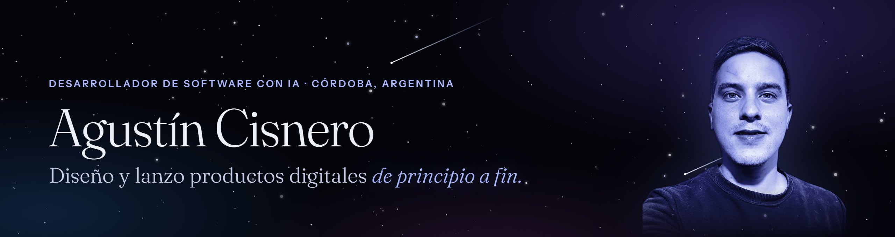
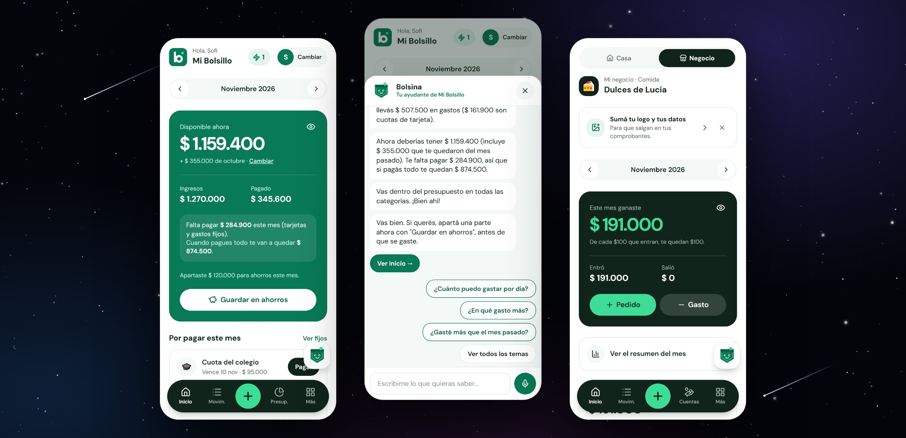
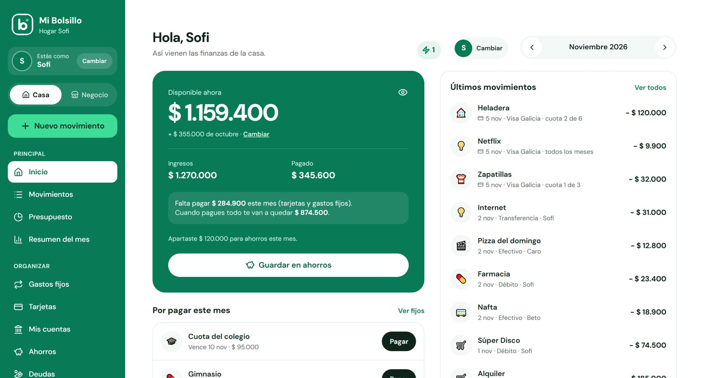

  

  
  
  
  

## Hola, soy Agustín 👋

Desarrollador de software con IA, de Córdoba, Argentina. Creé y lancé **[Mi Bolsillo](https://mibolsillo-app.com)**, una app de finanzas personales y para emprendedores que hoy está publicada y la usan personas reales. También desarrollé sistemas a medida para comercios y organizaciones.

Trabajo junto a asistentes de inteligencia artificial: **defino qué hay que construir, dirijo el desarrollo, pruebo cada entrega** y me ocupo de la base de datos, la publicación y la operación. Quiero seguir creciendo como desarrollador backend y frontend dentro de un equipo profesional.

## ✦ Trabajo destacado: Mi Bolsillo

App web instalable para ordenar la plata de la casa: gastos, tarjetas en cuotas, presupuesto, ahorros, deudas y cuentas. Incluye **Mi negocio**, una sección paga para emprendedores (ventas, cobros, fiado y comprobantes) con 30 días de prueba y suscripción por Mercado Pago.

- **Bolsina**, un asistente propio que responde con los números reales de cada familia y guía el primer uso.
- Modo oscuro, bloqueo con PIN o huella, notificaciones push y panel de administración.
- Backend en Supabase: migraciones SQL, funciones en la nube y seguridad de acceso a los datos (RLS).

`React` `Vite` `Tailwind` `Supabase` `PostgreSQL` `Edge Functions` `Railway`

## Proyectos

| Proyecto | Qué hace | Tecnologías |
|---|---|---|
| **Panadería Pro** | Punto de venta: caja en tiempo real, delivery, producción, insumos, proveedores, finanzas y personal, con permisos por rol. | React · Zustand · Supabase Realtime |
| **Panadería Mi Sueño** | Tienda online instalable: los pedidos llegan solos al sistema del local. | React · Supabase · PWA |
| **Giama Electricidad** | Gestión de clientes, presupuestos, materiales, personal, recibos y reportes en PDF. | Python · Flask · Supabase |
| **RUNA** | Sistema para bar: mesas, pedidos, caja, reservas, turnos y estadísticas. | React · Supabase |
| **MisClientes** | Clientes, pagos mensuales, calendario y avisos por WhatsApp. | Next.js · TypeScript · Prisma · Docker |
| **Ministerio de Varones** | Inscripciones, ingreso con escáner, caja y balance de eventos. | Python · Flask |
| **Fotos de casamiento** | Los invitados suben y ven las fotos y videos de la boda. | React · Supabase |

> Los proyectos para clientes tienen el código privado. Si querés ver alguno funcionando, escribime.

## Herramientas

  
  
  
  
  
  
  
  
  
  
  
  
  
  

## Cómo trabajo

1. Escucho al negocio y anoto qué necesita.
2. Lo divido en partes chicas y priorizo.
3. Dirijo el desarrollo con IA y pruebo cada entrega con datos reales.
4. Publico, acompaño a quien lo usa y mejoro con lo que me piden.

---

📍 Córdoba, Argentina · Español nativo · Inglés básico

